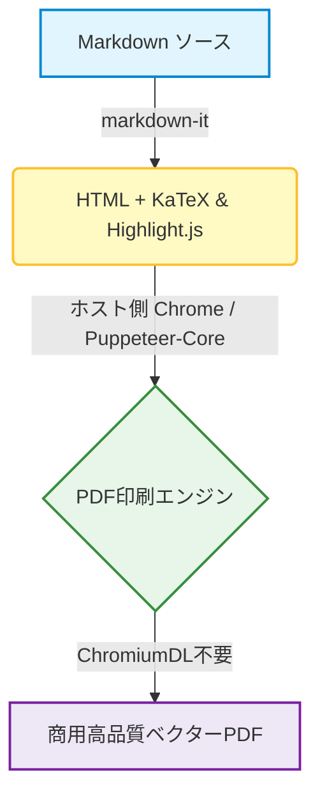

# md-to-pdf-lite 機能デモドキュメント

> Chromiumの追加ダウンロード不要。開発者ワークフロー、CI/CD自動化、CJK多言語ドキュメントに最適化された超軽量Markdown to PDFエンジン。

---

## 1. CJKタイポグラフィ＆多言語サポート

本プロジェクトは中日韓（CJK）フォント、文字組版、および約物（句読点）のスペーシングを徹底的に最適化しています：

- **日本語 (Japanese)**: ヒラギノ角ゴ (Hiragino Sans) および メイリオ (Meiryo) に最適化された美しいビジネス文書組版。
- **中文 (簡体字・繁体字)**: 苹方 (PingFang SC) や 微软雅黑 による、文字間隔が美しく読みやすい組版。
- **English**: クリスプな等幅コードフォントを備えたモダンなシステムUIタイポグラフィ。

### 1.1 御見積・帳票テーブル例

| 項目 | 区分 | 数量 | 単価 | 金額 |
| :--- | :---: | :---: | ---: | ---: |
| **Webアーキテクチャ設計・技術顧問** | 技術アドバイザリー | 1式 | ¥350,000 | **¥350,000** |
| **フロントエンド UI/UX 実装** | レスポンシブ設計 | 1式 | ¥280,000 | **¥280,000** |
| **CI/CD 自動化パイプライン構築** | GitHub Actions | 1式 | ¥120,000 | **¥120,000** |
| **総合計 (税込)** | — | — | — | **¥750,000** |

---

## 2. シンタックスハイライト (コード着色)

```typescript
import { convert } from 'md-to-pdf-lite';

async function generateReport() {
  const result = await convert({
    input: './proposal.md',
    output: './dist/proposal.pdf',
    format: 'A4',
    margin: { top: '20mm', bottom: '20mm' }
  });
  console.log(`PDFが出力されました: ${result.pdfPath}`);
}
```

---

## 3. 数式レンダリング (KaTeX)

アインシュタインの特殊相対性理論 $E = mc^2$ やベイズの定理 $P(A|B) = \frac{P(B|A)P(A)}{P(B)}$ などのインライン数式を、外部通信なしで完全オフライン描画します。

ブロック数式の例：

$$
\int_{-\infty}^{\infty} e^{-x^2} dx = \sqrt{\pi}
$$

<!-- pagebreak -->

# 2ページ目: 高度な機能

## 4. Mermaid ベクター図・フローチャート

GitHub形式のMermaid構文による、完全オフラインのベクターダイアグラム出力に対応しています：



---

## 5. 改ページ制御 (Page Break)

ドキュメント内の任意の位置に以下のタグを記述するだけで、意図した通りの改ページを挿入できます：
- `<!-- pagebreak -->`
- `---pagebreak---`
- `<div class="page"/>`

すべての表（テーブル）、ダイアグラム、コードブロックには `page-break-inside: avoid` が自動設定され、行や要素の途中分断を防止します。

---

## 6. 機能カバレッジ＆チェックリスト

- [x] Chromiumダウンロード不要（約5秒で即座にインストール完了）
- [x] ホスト環境の Chrome / Chromium / Edge / Brave を自動検出
- [x] CJKフォントおよび日本企業のビジネス帳票に最適化された組版
- [x] 完全オフラインでの Mermaid ベクターフローチャート描画
- [x] KaTeX による高精細な数式組版
- [x] シンタックスハイライト対応のコードブロック
- [x] クロスプラットフォーム CLI ＋ Node.js API サポート
- [x] GitHub Actions 自動 CI/CD パイプライン連携
