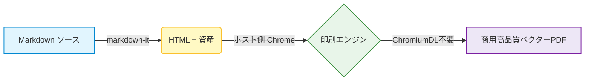

# md-to-pdf-lite 機能デモドキュメント

> Chromium不要。開発者ワークフローやCI/CD、CJK多言語文書に最適化された超軽量Markdown to PDFエンジン。

## 1. CJKタイポグラフィ＆商業帳票・見積テーブル

日本語（ヒラギノ角ゴ）、中文（苹方）、英語等幅フォントの約物・文字間隔を最適化：

| 項目 | 区分 | 数量 | 金額 |
| :--- | :---: | :---: | ---: |
| **Webアーキテクチャ設計・技術顧問** | 技術アドバイザリー | 1式 | **¥350,000** |
| **フロントエンド UI/UX 実装** | レスポンシブ設計 | 1式 | **¥280,000** |
| **総合計 (税込)** | — | — | **¥630,000** |

## 2. シンタックスハイライト (コードハイライト)

```typescript
import { convert } from 'md-to-pdf-lite';

async function generateReport() {
  return await convert({ input: './proposal.md', output: './dist/proposal.pdf' });
}
```

## 3. 数式レンダリング (KaTeX 数式)

特殊相対性理論 $E = mc^2$ やガウス積分の公式を完全オフライン描画します：

$$
\int_{-\infty}^{\infty} e^{-x^2} dx = \sqrt{\pi}
$$

<!-- pagebreak -->

# 2ページ目: 高度な機能

## 4. Mermaid ベクター図 (フローチャート・ダイアグラム)

GitHub形式のMermaid構文による、完全オフラインのベクターダイアグラム出力に対応：



## 5. 改ページ制御 (Page Break)

ドキュメント内の任意の位置に以下のタグを記述するだけで、意図した通りの改ページを挿入できます：
- `<!-- pagebreak -->` または `---pagebreak---`
- すべての表、ダイアグラム、コードブロックには `page-break-inside: avoid` が自動設定され、途中分断を防止します

## 6. 機能カバレッジ＆チェックリスト

- [x] Chromiumダウンロード不要（約5秒で即座にインストール完了）
- [x] ホスト環境の Chrome / Chromium / Edge / Brave を自動検出
- [x] CJKフォントおよび日本企業のビジネス帳票に最適化された組版
- [x] 完全オフラインでの Mermaid ベクターフローチャート描画
- [x] KaTeX による高精細な数式組版
- [x] シンタックスハイライト対応のコードブロック
- [x] クロスプラットフォーム CLI ＋ Node.js API サポート
- [x] GitHub Actions 自動 CI/CD パイプライン連携
