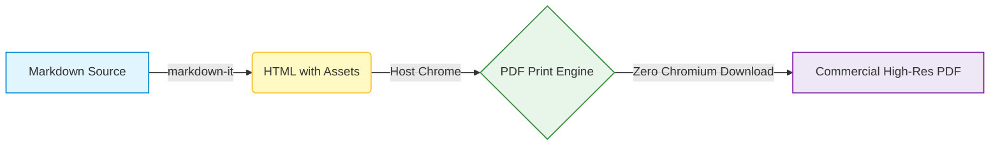

# md-to-pdf-lite Showcase Document

> Ultra-lightweight, zero-chromium Markdown to PDF engine tailored for developer workflows, CI/CD pipelines, and CJK documents.

## 1. CJK Typography & Multilingual Support

Deep optimization for Chinese, Japanese, and Korean (CJK) typography (商業帳票・見積テーブル):

- **CJK Fonts**: 优雅的苹方 (PingFang SC) and ヒラギノ角ゴ (Hiragino Sans), paired with monospace fonts.

| 項目 (Item) | 区分 (Category) | 数量 (Qty) | 金額 (Total Amount) |
| :--- | :---: | :---: | ---: |
| **Web Architecture Consulting** | Technical Advisory | 1式 | **¥350,000** |
| **Frontend UI/UX Design** | Responsive Layout | 1式 | **¥280,000** |
| **総合計 (Grand Total)** | — | — | **¥630,000** |

## 2. Syntax Highlighting (コードハイライト)

```typescript
import { convert } from 'md-to-pdf-lite';

async function generateReport() {
  return await convert({ input: './proposal.md', output: './dist/proposal.pdf' });
}
```

## 3. Mathematical Formulas (KaTeX 数式)

Inline formulas like Einstein's relation $E = mc^2$ and Gaussian integral blocks rendered with zero external network requests:

$$
\int_{-\infty}^{\infty} e^{-x^2} dx = \sqrt{\pi}
$$

<!-- pagebreak -->

# Page 2: Advanced Features

## 4. Mermaid Vector Diagrams (フローチャート・ダイアグラム)

Built-in offline vector diagramming with GitHub-style Mermaid syntax:



## 5. Native Page Break Support (改ページ機能)

You can easily insert a clean page break anywhere in your document using:
- `<!-- pagebreak -->` or `---pagebreak---`
- Tables, diagrams, and code blocks automatically receive `page-break-inside: avoid` so content never splits awkwardly.

## 6. Checklist & Feature Coverage

- [x] Zero-download Chromium (Instant installation in ~5s)
- [x] Auto-detect host Chrome, Chromium, Edge, or Brave
- [x] CJK fonts & Japanese business document formatting
- [x] Offline Mermaid diagram vector rendering
- [x] KaTeX math equations
- [x] Syntax-highlighted code blocks
- [x] Cross-platform CLI + Node.js API
- [x] Automated GitHub Actions CI/CD pipeline
