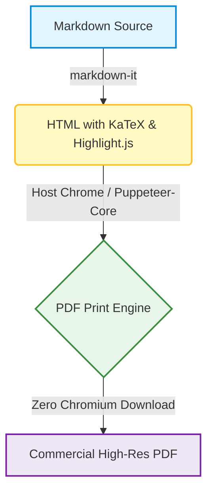

# md-to-pdf-lite Showcase Document

> An ultra-lightweight, zero-chromium-bundle Markdown to PDF engine tailored for developer workflows, CI/CD pipelines, and multi-language CJK documents.

---

## 1. CJK Typography & Multilingual Support

本项目针对中日韩（CJK）字体、排版与标点间距进行了深度优化：

- **中文 (Simplified & Traditional)**: 优雅的苹方（PingFang SC）与微软雅黑，字距清晰，行高舒适。
- **日本語 (Japanese)**: ヒラギノ角ゴ (Hiragino Sans) および メイリオ (Meiryo) に最適化された美しいビジネス文書組版。
- **English**: Modern system UI typography with crisp monospace code fonts.

### 1.1 Commercial Table (商業帳票・見積テーブル)

| 項目 (Item) | 区分 (Category) | 数量 (Qty) | 単価 (Unit Price) | 金額 (Total Amount) |
| :--- | :---: | :---: | ---: | ---: |
| **Web Architecture Consulting** | Technical Advisory | 1式 | ¥350,000 | **¥350,000** |
| **Frontend UI/UX Design** | Responsive Layout | 1式 | ¥280,000 | **¥280,000** |
| **CI/CD Automated Workflow** | GitHub Actions Pipeline | 1式 | ¥120,000 | **¥120,000** |
| **総合計 (Grand Total)** | — | — | — | **¥750,000** |

---

## 2. Syntax Highlighting (コードハイライト)

```typescript
import { convert } from 'md-to-pdf-lite';

async function generateReport() {
  const result = await convert({
    input: './proposal.md',
    output: './dist/proposal.pdf',
    format: 'A4',
    margin: { top: '20mm', bottom: '20mm' }
  });
  console.log(`PDF generated at: ${result.pdfPath}`);
}
```

---

## 3. Mathematical Formulas (KaTeX 数式)

Inline formulas like Einstein's relation $E = mc^2$ or Bayes' theorem $P(A|B) = \frac{P(B|A)P(A)}{P(B)}$ are rendered cleanly without external network calls.

Display block equation:

$$
\int_{-\infty}^{\infty} e^{-x^2} dx = \sqrt{\pi}
$$

<!-- pagebreak -->

# Page 2: Advanced Features

## 4. Mermaid Vector Diagrams (フローチャート・ダイアグラム)

Built-in offline vector diagramming with GitHub-style Mermaid syntax:



---

## 5. Native Page Break Support (改ページ機能)

You can easily insert a clean page break anywhere using:
- `<!-- pagebreak -->`
- `---pagebreak---`
- `<div class="page"/>`

Tables, diagrams, and code blocks are automatically configured with `page-break-inside: avoid` so that table rows and flowcharts never split awkwardly across page margins.

---

## 6. Checklist & Feature Coverage

- [x] Zero-download Chromium (Instant installation in ~5s)
- [x] Auto-detect host Chrome, Chromium, Edge, or Brave
- [x] CJK fonts & Japanese business document formatting
- [x] Offline Mermaid diagram vector rendering
- [x] KaTeX math equations
- [x] Syntax-highlighted code blocks
- [x] Cross-platform CLI + Node.js API
- [x] Automated GitHub Actions CI/CD pipeline
