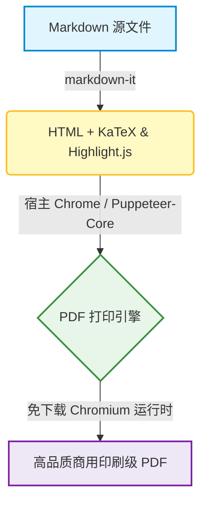

# md-to-pdf-lite 功能特性演示文档

> 超轻量、免下载 Chromium 的 Markdown 转 PDF 引擎，专为开发者工作流、CI/CD 自动化流水线及中日韩 (CJK) 多语言文档量身打造。

---

## 1. CJK 字体排版与多语言支持

本项目针对中日韩（CJK）字体、排版与标点间距进行了深度优化：

- **中文 (简体 & 繁体)**: 优雅的苹方（PingFang SC）与微软雅黑，字距清晰，行高舒适。
- **日本語 (Japanese)**: 针对ヒラギノ角ゴ (Hiragino Sans) 与メイリオ (Meiryo) 进行深度优化的高品质商务文档排版。
- **English**: 现代化的系统级 UI 字体与清晰易读的等宽代码字体。

### 1.1 商务报价表格示例

| 项目名称 | 业务类别 | 数量 | 单价 | 金额 |
| :--- | :---: | :---: | ---: | ---: |
| **Web 架构咨询与设计** | 技术专家顾问 | 1 项 | ¥350,000 | **¥350,000** |
| **前端 UI/UX 界面开发** | 响应式交互设计 | 1 项 | ¥280,000 | **¥280,000** |
| **CI/CD 自动化部署流水线** | GitHub Actions | 1 项 | ¥120,000 | **¥120,000** |
| **费用总计** | — | — | — | **¥750,000** |

---

## 2. 代码高亮与语法着色

```typescript
import { convert } from 'md-to-pdf-lite';

async function generateReport() {
  const result = await convert({
    input: './proposal.md',
    output: './dist/proposal.pdf',
    format: 'A4',
    margin: { top: '20mm', bottom: '20mm' }
  });
  console.log(`PDF 已成功生成: ${result.pdfPath}`);
}
```

---

## 3. 数学公式排版 (KaTeX)

支持行内公式如爱因斯坦质能方程 $E = mc^2$ 或贝叶斯定理 $P(A|B) = \frac{P(B|A)P(A)}{P(B)}$，完全离线高精度渲染，无需依赖任何外部网络。

块级公式示例：

$$
\int_{-\infty}^{\infty} e^{-x^2} dx = \sqrt{\pi}
$$

<!-- pagebreak -->

# 第 2 页：进阶功能与架构

## 4. Mermaid 矢量图表渲染

原生集成离线矢量图表生成，完美支持 GitHub 风格的 Mermaid 流程图语法：



---

## 5. 原生分页控制 (Page Break)

你可以随时使用以下任意标记在文档中插入干净利落的分页符：
- `<!-- pagebreak -->`
- `---pagebreak---`
- `<div class="page"/>`

所有表格、代码块及图表均默认注入 `page-break-inside: avoid`，彻底告别表格行被跨页硬生生裁断的尴尬体验。

---

## 6. 特性支持清单

- [x] 免下载 Chromium（极速安装，耗时仅约 5 秒）
- [x] 智能自动定位宿主 Chrome、Chromium、Edge 或 Brave 浏览器
- [x] 针对中日韩（CJK）字体与商务文档排版深度调优
- [x] 离线 Mermaid 矢量图表直接转绘
- [x] 高保真 KaTeX 数学公式原生渲染
- [x] 丰富多样的语法着色与代码高亮支持
- [x] 跨平台 CLI 命令行工具与 Node.js 编程式 API
- [x] 完善的 GitHub Actions CI/CD 自动化构建
